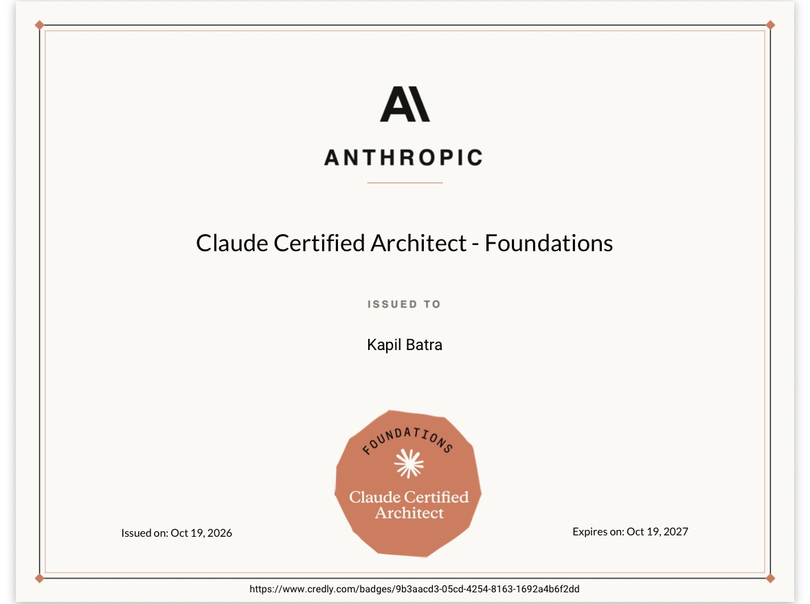

# CCA-F Mock Exam

A free, full-length practice exam for the **Claude Certified Architect – Foundations (CCA-F)** certification.

  

  
  &nbsp;
  

<b>Exam link:</b> <a href="https://batra-kapil.github.io/cca-f-mock-exam/">batra-kapil.github.io/cca-f-mock-exam</a> 
If it helped you, please ⭐ star the repo and follow me for more Claude and Salesforce content.

## Why I built this

I used this mock exam to prepare for CCA-F, and passed the real exam on October 19, 2026.

  
   
  <a href="https://www.credly.com/badges/9b3aacd3-05cd-4254-8163-1692a4b6f2dd">Verify on Credly</a>

## What's inside

- **60 scenario-based questions** in 120 minutes, the same length and time limit as the real exam
- **All six production scenarios**, ten questions each:
  - Customer Support Resolution Agent
  - Code Generation with Claude Code
  - Multi-Agent Research System
  - Developer Productivity with Claude
  - Claude Code for CI/CD
  - Structured Data Extraction
- **Weighted to the official domain blueprint**

  | Domain | Weight | Questions |
  |---|---|---|
  | Agentic Architecture & Orchestration | 27% | 16 |
  | Claude Code Configuration & Workflows | 20% | 12 |
  | Prompt Engineering & Structured Output | 20% | 12 |
  | Tool Design & MCP Integration | 18% | 11 |
  | Context Management & Reliability | 15% | 9 |

- **Instant feedback:** pick an option and the correct answer lights up, with a one-line reason why it's right and why each other option is wrong
- **Results report:** score out of 1000 against the 720 pass line, plus breakdowns by domain and by scenario, and a list of missed questions to review
- **Balanced answer key**, so you can't pass by guessing a letter
- Progress and timer save in your browser. Works on desktop and mobile, in light and dark mode.

## How to use it

1. Take it in one sitting, without notes, and treat it like the real thing.
2. Aim for **750+** with every domain above 72% before you book.
3. Review every missed question. The rationale lines are where the learning happens.

## Run it locally

It's a single self-contained `index.html` file with no build step. Download it and open it in any browser.

## Disclaimer

This is an independent practice set written against the publicly available CCA-F exam guide. It is not affiliated with or endorsed by Anthropic, and these are not real exam questions.

---

Built by [Kapil Batra](https://github.com/batra-kapil) · Salesforce MVP · Claude Certified Architect – Foundations

For more Salesforce and AI content, subscribe on YouTube: https://www.youtube.com/salesforcebolt
